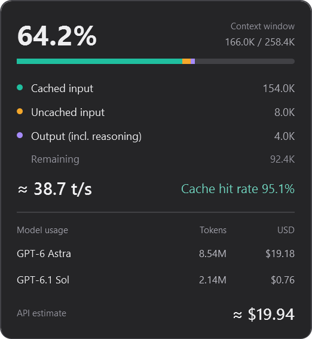
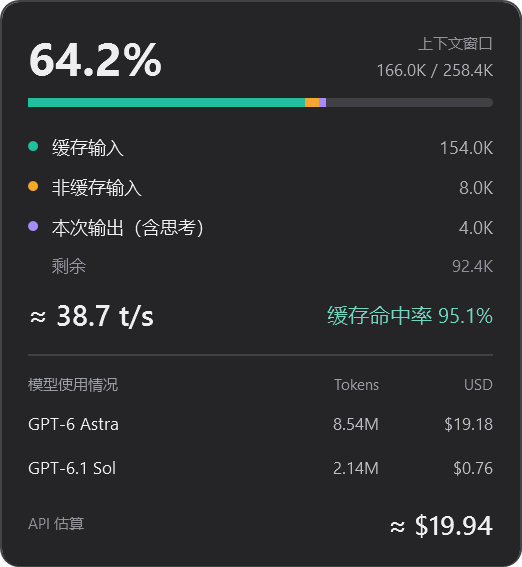

# Codex Context Monitor

[简体中文](README.zh-CN.md) · English

A compact Windows companion for the Codex desktop app. See context usage, the last response's estimated token speed, cache hit rate, model usage, and estimated API token cost.




The screenshots use sample data rendered by the actual WPF interface.

## Features

- Follows the chat open in the Codex window; no manual chat selector.
- Small, transparent status bar. Click to expand; click outside the panel to close it.
- Context breakdown: cached input, uncached input, output including reasoning, and remaining space.
- Cumulative token usage and an API cost estimate for each model used in the chat.
- Chinese or English selected from the Windows display language. Other languages fall back to English.
- No notification-area icon. The overlay starts and stops with the Codex window.


## Install

Requires Windows 10/11, Windows PowerShell 5.1, and Python 3.10 or newer on PATH. No Python packages are required.

Download and extract the ZIP from the [latest release](https://github.com/Cand1ePower/codex-context-monitor/releases/latest), then run `Install.ps1` from the extracted folder. Alternatively, clone the repository:

```powershell
git clone https://github.com/Cand1ePower/codex-context-monitor.git
cd codex-context-monitor
powershell.exe -NoProfile -File .\Install.ps1
```

The installer copies the app to `%LOCALAPPDATA%\CodexContextMonitor\app` and adds a managed entry to your user Startup folder. It starts immediately if Codex is already open. Administrator access is not needed.

A hidden watcher checks for the Codex window every two seconds. The overlay and Python reader exit when Codex closes; the small watcher remains available for the next launch. It has no window or tray icon. Minimized or background Codex windows hide the overlay.

To start without installing, double-click `Launch.vbs`. To stop the monitor and watcher, run `Quit.ps1`. Run `Uninstall.ps1` to stop them and remove automatic startup; preferences and installed files are retained.

## Use and settings

Click the ring or metrics to open the panel. Click anywhere outside it to close. Hover over the left edge of the status bar to reveal the drag handle. Its position is saved relative to the Codex window.

Hover over a model row for exact input, cached-input, output, total-token and response counts. Click **API estimate** to open the official pricing page.

Optional overrides go in `%LOCALAPPDATA%\CodexContextMonitor\settings.json`:

```json
{"language": "en-US"}
```

Use `zh-CN` for Chinese or `auto` for Windows-language detection. A `python` field can specify an absolute Python executable path when PATH discovery is insufficient. Restart the monitor after changing settings.

## What the numbers mean

**Context usage** is the latest response's input plus output, divided by the reported context window. Cached tokens still occupy context. **Cache hit rate** is cached input divided by total input. **Speed** is an estimate from local generation timestamps and output tokens, including reasoning; it updates when a response usage record arrives. It is not an instantaneous, token-by-token decoder measurement.

**Model usage** sums distinct responses throughout this chat's local transcript, including repeated inputs. These totals can be much larger than the current context. Duplicate usage events are not counted twice, and compaction does not reset the totals. Separate child chats are not included.

**API estimate** is a USD token-cost estimate, not a ChatGPT subscription bill or an amount actually charged. Rates were checked on **2026-11-06** against [official pricing](https://developers.openai.com/api/docs/pricing) and the model pages linked in `pricing.json`. Supported rates: GPT-6 Astra, GPT-6.1 Sol, GPT-6.1 Terra, GPT-6 Sol, and GPT-6 Luna. Unknown models or unsupported tiers show **Unpriced**; a partial subtotal is identified.

Calculation is per response: regular input, cached input, cache writes and output have separate prices. Reasoning is already included in output. The long-context adjustment applies when a request exceeds 272K input tokens. Recorded Fast/priority, Flex and Batch tiers are supported. Missing service tiers are estimated at Standard; missing cache retention is estimated at 30 minutes. Tool fees, regional premiums, and subscription allowances are excluded. The estimate tooltip explains these assumptions without adding a permanent notice to the panel.

## Data and compatibility

This is an unofficial companion, not a native Codex extension. It does not patch the Codex installation, call a model, read credentials, or upload chat data. The monitor reads the current user's Codex desktop logs, local thread index, and local usage records. It retains usage metadata, not message bodies. Opening the pricing link is the only browser action.

Active-chat detection uses the desktop log's current window route, not the most recently active background task. New-chat and unsupported pages clear the selection. These are internal local formats and can change after a Codex update. The current implementation was tested against Windows Codex app version `26.1027.51404`. Cloud-only chats without local usage records cannot be priced. Multi-window selection depends on available window-focus log entries.

## Development checks

```powershell
python -m unittest discover -s tests -p "test_*.py"
powershell.exe -NoProfile -File .\tests\test_ui.ps1
powershell.exe -NoProfile -STA -File .\Overlay.ps1 -ValidateOnly
```

Render a panel directly from the sample fixture:

```powershell
powershell.exe -NoProfile -STA -File .\Overlay.ps1 -RenderPreview -Language en-US -PreviewState .\tests\demo-state.json -PreviewOutput .\preview
```

The automatic checks cover cost arithmetic, deduplication, model changes, compaction, file truncation, history beyond the former tail limit, active-window routes, language selection and lifecycle decisions. They do not replace visual testing after a Codex or Windows update.
