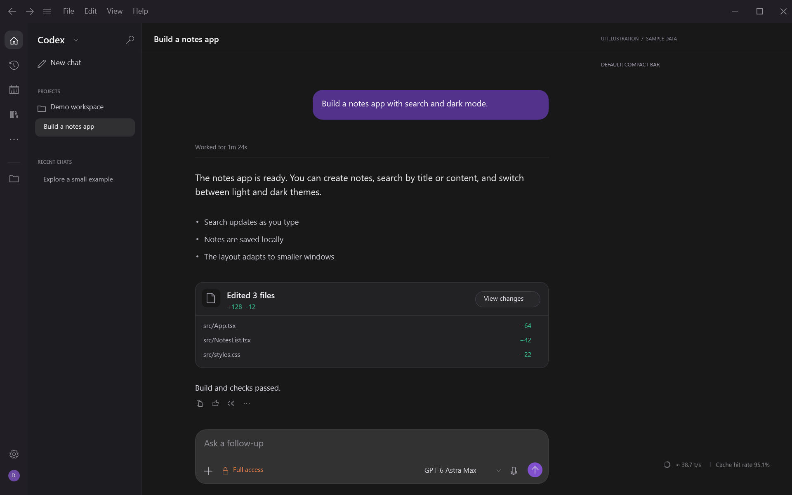
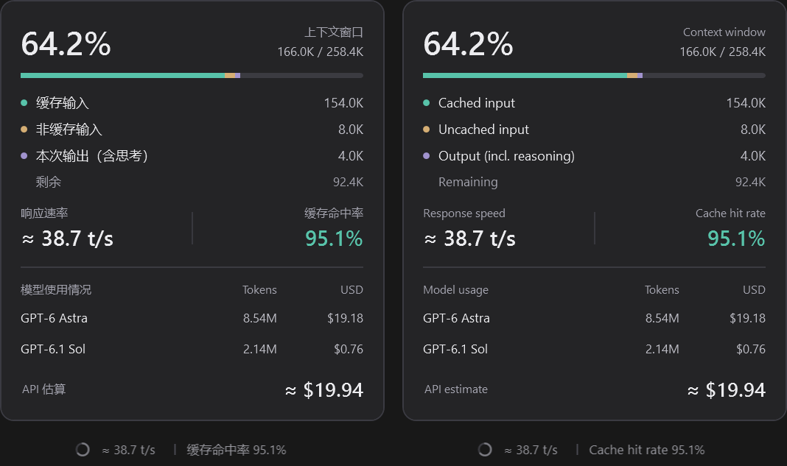

# Codex Context Monitor — context window & token usage for Windows

[简体中文](README.zh-CN.md) · English

**Codex Context Monitor** tracks context window and token usage in the **Windows Codex desktop app**.

Its floating status bar shows context usage, estimated token speed, prompt cache hit rate, cumulative tokens by model, and estimated API cost for the current chat. It follows the open chat automatically and selects Chinese or English from the system language.

**The compact status bar is shown by default.** Click the ring or metrics to expand the panel; click outside to close it.



**Expanded view**


Illustrations use sample chats and metrics. The overlay is rendered from the actual application.

## Features

- Follows the chat open in the Codex window and updates when you switch chats.
- Transparent compact bar; click to expand and click outside to close.
- Cached input, uncached input, output including reasoning, and remaining context.
- Cumulative tokens and estimated API cost for each model used in the chat.
- Chinese or English selected from the Windows display language; other languages use English.
- No tray icon. The overlay starts and stops with the Codex window.

## Install

Copy this into Codex:

```text
Install https://github.com/Cand1ePower/codex-context-monitor on this computer. Read the README and installation scripts.
```

A hidden watcher checks for the Codex window every two seconds. When Codex closes, the overlay and reader exit; the watcher waits for the next launch.

## Use and settings

Click the ring or metrics to open the panel; click anywhere outside it to close. Hover over the left edge of the status bar to reveal the drag handle. Its position is saved relative to the Codex window.

Hover over a model row for exact input, cached-input, output, total-token and response counts. Click **API estimate** to open the official pricing page.

Run `Quit.ps1` to stop the tool, or `Uninstall.ps1` to remove automatic startup.

<details>
<summary>See Chinese and English panel details and compact bars</summary>



</details>

## What the numbers mean

Context usage is the latest response's input plus output tokens divided by its reported context window. Cached tokens still occupy context. Cache hit rate is cached input divided by all input. Speed is estimated from local generation timestamps and output tokens, including reasoning. It updates with usage records and is not an instantaneous token-by-token measurement.

Cost is a USD API token estimate, not a ChatGPT subscription bill or an actual charge. Sources are the [official pricing page](https://developers.openai.com/api/docs/pricing) and the model pages in `pricing.json`. Supported models: GPT-6 Astra, GPT-6.1 Sol, GPT-6.1 Terra, GPT-6 Sol, and GPT-6 Luna. Unknown models or unsupported tiers show **Unpriced**, and partial totals are identified.

Each response is priced separately for regular input, cached input, cache writes, and output. Reasoning is already included in output. Long-context rates apply above 272K input tokens. Recorded Fast/priority, Flex, and Batch tiers are supported; missing tiers use Standard, and missing cache retention uses 30 minutes. Tool fees, regional premiums, and subscription allowances are excluded. The cost tooltip retains these assumptions.
