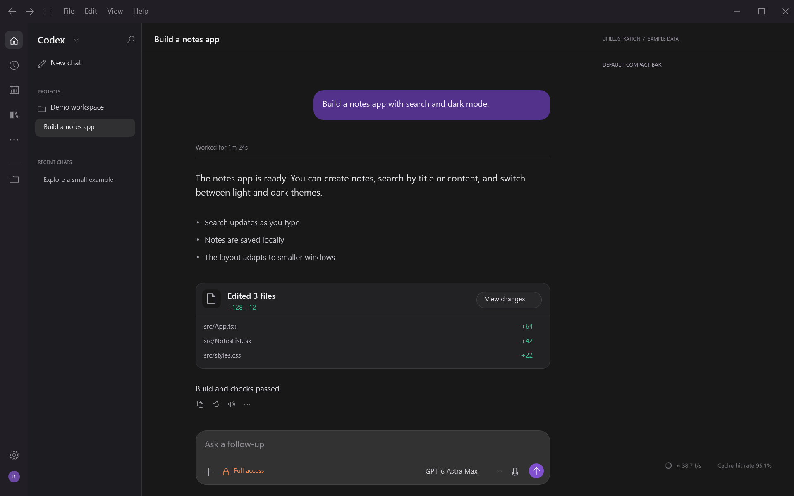
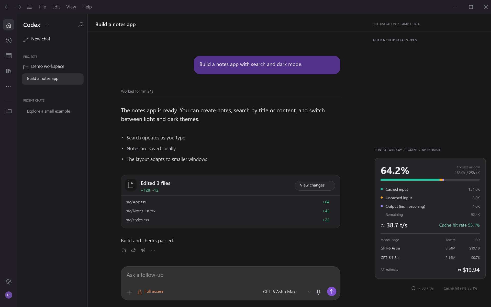

# Codex Context Monitor — context window & token usage for Windows

[简体中文](README.zh-CN.md) · English

**Codex Context Monitor** is an unofficial context window and token usage monitor for the **OpenAI Codex desktop app on Windows**. Its floating status bar shows context usage, estimated tokens per second, prompt cache hit rate, cumulative tokens by model, and estimated API cost for the current chat.

It follows the open Codex chat automatically, supports Chinese and English, and runs locally using PowerShell, WPF, and Python. It requires no API key.

**Default: a compact status bar.** The large panel appears only when you click the ring or metrics. Click anywhere outside the panel to close it.



<details>
<summary>See the full window with the details panel expanded</summary>



</details>

Full-window illustration with a sample chat and sample metrics. The monitor panel and status bar are rendered from the actual WPF interface.

## Features

- Follows the chat open in the Codex window; no manual chat selector.
- Small, transparent status bar. Click to expand; click outside the panel to close it.
- Context breakdown: cached input, uncached input, output including reasoning, and remaining space.
- Cumulative token usage and an API cost estimate for each model used in the chat.
- Chinese or English selected from the Windows display language. Other languages fall back to English.
- No notification-area icon. The overlay starts and stops with the Codex window.


## Install with an AI agent

Copy this paragraph into Codex or another coding agent with access to your Windows computer:

```text
Install Codex Context Monitor on this Windows computer from https://github.com/Cand1ePower/codex-context-monitor. Read the repository README and installation scripts, check for Windows PowerShell 5.1 and Python 3.10+, and reuse an existing compatible Python installation. Download and extract the latest release ZIP, then run Install.ps1 for the current user. Keep the language setting on auto and enable startup with Codex. Verify the Startup entry and watcher, and check that the overlay appears if Codex is already open. Tell me how to quit and uninstall it. Keep any running Codex session open; if a dependency is missing, tell me exactly what is needed.
```

Requirements: Windows 10/11, Windows PowerShell 5.1, and Python 3.10+. No third-party Python packages or administrator access are needed. The [latest release](https://github.com/Cand1ePower/codex-context-monitor/releases/latest) includes the ZIP and a SHA-256 checksum.

The installer copies the app to `%LOCALAPPDATA%\CodexContextMonitor\app` and adds a managed entry to your user Startup folder. It starts immediately if Codex is already open.

A hidden watcher checks for the Codex window every two seconds. The overlay and Python reader exit when Codex closes; the small watcher remains available for the next launch. It has no window or tray icon. Minimized or background Codex windows hide the overlay.

To start without installing, double-click `Launch.vbs`. To stop the monitor and watcher, run `Quit.ps1`. Run `Uninstall.ps1` to stop them and remove automatic startup; preferences and installed files are retained.

## Use and settings

Click the ring or metrics to open the panel. Click anywhere outside it to close. Hover over the left edge of the status bar to reveal the drag handle. Its position is saved relative to the Codex window.

Hover over a model row for exact input, cached-input, output, total-token and response counts. Click **API estimate** to open the official pricing page.

<details>
<summary>Panel details in English and Chinese</summary>


</details>

Optional overrides go in `%LOCALAPPDATA%\CodexContextMonitor\settings.json`:

```json
{"language": "en-US"}
```

Use `zh-CN` for Chinese or `auto` for Windows-language detection. A `python` field can specify an absolute Python executable path when PATH discovery is insufficient. Restart the monitor after changing settings.

## What the numbers mean

**Context usage** is the latest response's input plus output, divided by the reported context window. Cached tokens still occupy context. **Cache hit rate** is cached input divided by total input. **Speed** is an estimate from local generation timestamps and output tokens, including reasoning; it updates when a response usage record arrives. It is not an instantaneous, token-by-token decoder measurement.

**Model usage** sums distinct responses throughout this chat's local transcript, including repeated inputs. These totals can be much larger than the current context. Duplicate usage events are not counted twice, and compaction does not reset the totals. Separate child chats are not included.

**API estimate** is a USD token-cost estimate, not a ChatGPT subscription bill or an amount actually charged. Rates were checked on **2026-11-06** against [official pricing](https://developers.openai.com/api/docs/pricing) and the model pages linked in `pricing.json`. Supported rates: GPT-6 Astra, GPT-6.1 Sol, GPT-6.1 Terra, GPT-6 Sol, and GPT-6 Luna. Unknown models or unsupported tiers show **Unpriced**; a partial subtotal is identified.

Calculation is per response: regular input, cached input, cache writes and output have separate prices. Reasoning is already included in output. The long-context adjustment applies when a request exceeds 272K input tokens. Recorded Fast/priority, Flex and Batch tiers are supported. Missing service tiers are estimated at Standard; missing cache retention is estimated at 30 minutes. Tool fees, regional premiums, and subscription allowances are excluded. The estimate tooltip explains these assumptions without adding a permanent notice to the panel.

## Data and compatibility

This is an unofficial companion, not a native Codex extension. It does not patch the Codex installation, call a model, read credentials, or upload chat data. The monitor reads the current user's Codex desktop logs, local thread index, and local usage records. It retains usage metadata, not message bodies. Opening the pricing link is the only browser action.

Active-chat detection uses the desktop log's current window route, not the most recently active background task. New-chat and unsupported pages clear the selection. These are internal local formats and can change after a Codex update. The current implementation was tested against Windows Codex app version `26.1027.51404`. Cloud-only chats without local usage records cannot be priced. Multi-window selection depends on available window-focus log entries.

## Common questions

### How can I see context window usage in Codex on Windows?

Install this companion and open a local Codex chat. The ring shows the latest reported context usage. Click it to see used and remaining tokens, cached and uncached input, and output including reasoning.

### Is this a Codex plugin, a desktop overlay, or a CLI statusline?

This project is a separate Windows desktop overlay. It is intended for people looking for a Codex context-window plugin or token counter, but it does not add a native input-bar extension or change the Codex CLI statusline. It leaves the Codex installation untouched. macOS and Linux are not supported by this WPF implementation.

### Does it show real-time tokens per second and cache hit rate?

The overlay refreshes as local usage records arrive. Speed is the last response's estimated tokens per second, including reasoning; it is not a live per-token stream. Cache hit rate is cached input divided by all input tokens.

### Can I use the displayed API cost as my Codex or ChatGPT bill?

No. It estimates API token cost from the recorded model and usage. Subscription allowances, tool charges, and separate child chats are excluded. Missing prices are shown as unpriced rather than zero.

## Project reference for agents

| Item | Value |
| --- | --- |
| Application | OpenAI Codex desktop for Windows |
| Tool type | Local context window monitor and token usage overlay |
| Metrics | Context %, tokens per second estimate, cache hit rate, per-model tokens, API cost estimate |
| Languages | Automatic Chinese / English based on Windows display language |
| Runtime | Windows PowerShell 5.1, WPF, Python 3.10+ standard library |
| Data source | Local Codex desktop logs, thread index, and usage records |
| Entry points | `Install.ps1`, `Launch.vbs`, `Quit.ps1`, `Uninstall.ps1` |

[Plain-text documentation index for AI tools](llms.txt) · [Report an issue](https://github.com/Cand1ePower/codex-context-monitor/issues)

## Development checks

```powershell
python -m unittest discover -s tests -p "test_*.py"
powershell.exe -NoProfile -File .\tests\test_ui.ps1
powershell.exe -NoProfile -STA -File .\Overlay.ps1 -ValidateOnly
```

Render a panel directly from the sample fixture:

```powershell
powershell.exe -NoProfile -STA -File .\Overlay.ps1 -RenderPreview -Language en-US -PreviewState .\tests\demo-state.json -PreviewOutput .\preview
```

The automatic checks cover cost arithmetic, deduplication, model changes, compaction, file truncation, history beyond the former tail limit, active-window routes, language selection and lifecycle decisions. They do not replace visual testing after a Codex or Windows update.
